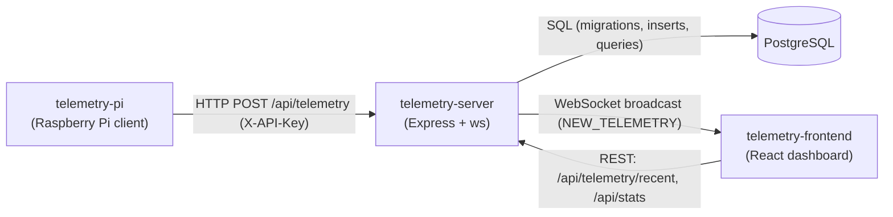

# telemetry-server

Collector server for EFR32 IC validation telemetry. It ingests device telemetry over
HTTP, validates and persists it to PostgreSQL, and broadcasts each sample to connected
dashboards over WebSockets.

This is the hub of a three-repo system:



Plain-text view: **Pi → HTTP → server → PostgreSQL**, and **server → WebSocket → React
dashboard** (which also seeds itself via REST).

## Responsibilities

- Validate incoming telemetry at the edge of the API (zod) and persist it atomically.
- Own the schema via migrations.
- Broadcast live samples to dashboards; serve recent history and aggregate stats.
- Manage validation **sessions** (one device-under-test run).

## API

| Method | Path                    | Auth        | Purpose                                |
| ------ | ----------------------- | ----------- | -------------------------------------- |
| GET    | `/health`               | —           | Liveness                               |
| GET    | `/ready`                | —           | Readiness (checks DB)                  |
| POST   | `/api/telemetry`        | `X-API-Key` | Ingest a sample; persist + broadcast   |
| GET    | `/api/telemetry/recent` | —           | Latest samples (dashboard seed)        |
| GET    | `/api/stats`            | —           | Aggregate PASS/WARN/FAIL counts        |
| POST   | `/api/sessions`         | `X-API-Key` | Create a test session                  |
| GET    | `/api/sessions`         | —           | List sessions                          |
| GET    | `/api/sessions/:id`     | —           | Fetch one session                      |
| PATCH  | `/api/sessions/:id`     | `X-API-Key` | Update session status (e.g. COMPLETED) |

Writes require `X-API-Key` only when `INGEST_API_KEY` is configured (always, in production).

## Stack

Node 22, TypeScript, Express 5, `pg`, `ws`, zod (validation), pino (logging),
node-pg-migrate (migrations). Tests: Jest + supertest.

## Setup

```bash
cp .env.example .env         # fill in PGPASSWORD at minimum
npm install
npm run migrate              # apply the schema
npm run dev                  # http://localhost:3000
```

Configuration is read and validated from the environment (see `.env.example`). Required
secret: `PGPASSWORD`. In production the app refuses to boot without `INGEST_API_KEY` or
with `CORS_ORIGIN=*`.

## Scripts

`dev` (watch), `build` (→ `dist`), `start` (run build), `migrate` / `migrate:down`,
`lint`, `format`, `test`.

## Docker

```bash
docker compose up --build
```

Brings up PostgreSQL + server (migrations run on start) + the frontend (built from the
sibling `../telemetry-frontend`), served on http://localhost:5173.

## Project structure

```
src/
  config.ts        validated env config
  db/              pool + migration runner
  schemas/         zod request schemas (+ inferred types)
  services/        SQL + transactions
  routes/          HTTP endpoints (thin)
  middleware/      error handler, API-key auth
  ws/              WebSocket server + broadcast
  app.ts           composition; server.ts: listen + graceful shutdown
migrations/        node-pg-migrate SQL migrations
```

See [DECISIONS.md](./DECISIONS.md) for the rationale behind the design.

## Tests

Integration tests use a real PostgreSQL (your local one for development; a service
container in CI) and are hermetic — each creates and tears down its own session, so they
don't depend on pre-seeded data. Point them at a DB via the same `PG*` env vars; CI applies
migrations first.

## A note on AI-assisted development

This project was productized with heavy use of AI coding tools (Claude Code), used as a
pair-programmer: proposing changes, explaining tradeoffs, and generating tests — with each
change reviewed and understood before being kept. The `DECISIONS.md` files capture the
"why" behind the choices.
